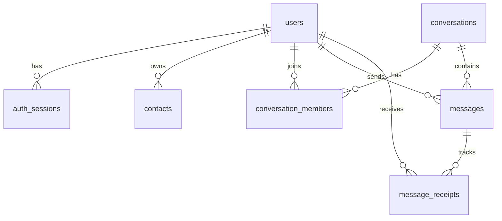

# Signal Clone

A functional clone of **Signal Desktop**: phone/username onboarding, contacts, real-time 1:1 and group messaging with typing indicators and sent → delivered → read receipts, and Signal's look and feel (light and dark).

> Built for the Scaler SDE Fullstack assignment. Encryption, calls, stories and linked devices are simulated or placeholders, as the assignment allows.

## Demo accounts

The database is seeded automatically on first start. Every account uses the fixed OTP **`123456`**.

| Log in with | Name |
|---|---|
| `+15550000001` or `alice` | Alice Johnson (has unread chats and is admin of "Weekend Trip ⛰️") |
| `+15550000002` or `bob` | Bob Smith |
| `carol`, `david`, `emma`, `frank`, `grace`, `henry` | Other seeded users |

Any new phone number or username registers a new account. Open two browsers (or a normal and a private window) as different users to see real-time messaging, typing and receipts. As Alice, try **New chat → "henry"** to add a contact who isn't saved yet.

## Features

| Area | What works |
|---|---|
| Onboarding | Register/login with phone number or username, mocked OTP, display name and avatar upload, session persists across reloads, logout revokes the session |
| Chat list | Sorted by latest activity, live reordering, unread badges, last-message preview ("You: …", "Bob: …"), online dot, search over chats and contacts, filters (All / Unread / Groups) |
| Contacts | Find a user by phone/username and save them as a contact, from **New chat**, **New group** or a group's **Add members** dialog; start a chat from contacts |
| 1:1 messaging | Real-time send/receive over WebSockets, timestamps, typing indicator, status icons for sending / sent / delivered / read, failed sends with retry, cursor-paginated history, all persisted |
| Groups | Create with name and members, group messages with sender names and avatars, member list with admin badges, admins add/remove members and rename, leave group (admin auto-promotion), live system messages ("Alice added Bob") |
| Signal UX | Nav rail plus chat list plus chat pane, message clustering, date separators, conversation details panel, modals, toasts for incoming messages and actions, settings (Profile and Appearance work; others are placeholders), simulated E2EE notices and safety number |
| Placeholders | Voice/video calls, Stories, Linked devices, disappearing messages, attachments, emoji: "Coming soon" |
| Bonus | Dark mode (System/Light/Dark), responsive layout (phone shows list *or* chat), keyboard shortcuts (`Ctrl/⌘+K` search, `Alt+↑/↓` switch chat, `Ctrl/⌘+,` settings, `Esc` close) |

## Tech stack

| Layer | Choice |
|---|---|
| Frontend | Next.js 15 (App Router), React 19, TypeScript, Tailwind CSS v4, Zustand (state), sonner (toasts) |
| Backend | Python 3.12, FastAPI, SQLAlchemy 2.0, Pydantic v2 |
| Database | SQLite (WAL mode, foreign keys enforced) |
| Real-time | Native WebSockets (FastAPI ↔ browser) |
| Tests | pytest + FastAPI TestClient (HTTP and WebSocket) |

## Running locally

**Prerequisites:** Python 3.12+ and Node.js 20+.

```bash
# Backend: http://localhost:8000 (API docs at /docs)
cd backend
python3.12 -m venv .venv
.venv/bin/pip install -r requirements.txt
cp .env.example .env
.venv/bin/uvicorn app.main:app --reload --port 8000

# Frontend: http://localhost:3000
cd frontend
npm install
cp .env.example .env.local
npm run dev
```

The SQLite file (`backend/signal.db`) and seed data are created on first start. To reset the demo data, run `.venv/bin/python -m app.seed --reset`.

**Checks**

```bash
cd backend && .venv/bin/pytest && .venv/bin/ruff check . && .venv/bin/ruff format --check .
cd frontend && npx tsc --noEmit && npm run lint && npm run format:check && npm run build
```

### Configuration

| Variable | Where | Default | Purpose |
|---|---|---|---|
| `CORS_ORIGINS` | backend | `http://localhost:3000` | Comma-separated allowed frontend origins |
| `DATABASE_URL` | backend | `sqlite:///./signal.db` | SQLite file location |
| `MEDIA_DIR` | backend | `./media` | Uploaded avatars |
| `MOCK_OTP` | backend | `123456` | The fixed verification code |
| `DEMO_MODE` | backend | `true` | Show the OTP hint on the verification screen |
| `SEED_ON_STARTUP` | backend | `true` | Seed demo data when the DB is empty |
| `NEXT_PUBLIC_API_URL` | frontend | `http://localhost:8000` | Backend URL (REST and WebSocket) |

## Architecture

```
Browser (Next.js)                                FastAPI (single process)
┌──────────────────────────────┐   REST /api/v1  ┌──────────────────────────────────────┐
│ Pages ─ Components           │ ──────────────► │ Routes → Services → SQLAlchemy models │
│ Zustand stores (auth, chat)  │                 │            │ after commit             │
│ api.ts (fetch) socket.ts (WS)│ ◄────────────── │ ConnectionManager (user → sockets)    │
└──────────────────────────────┘   WS /ws        └───────────────┬──────────────────────┘
                                                                  ▼
                                                        SQLite (+ media/ for avatars)
```

- **Writes go over REST, pushes go over the WebSocket.** Sending is a `POST` (validated, idempotent through a client-generated `client_message_id`). After the commit the server pushes `message.new` to every member's open sockets. The HTTP response doubles as the "sent" acknowledgement.
- **Receipts.** Every message gets one `message_receipts` row per recipient. A message is *delivered* when it reaches a recipient's open socket (or when they reconnect) and *read* when they open the chat. The sender sees the aggregate (all recipients), pushed as `message.status`.
- **Ephemeral signals** (typing, presence) only travel over the socket and are never stored, except `users.last_seen_at`.
- **Frontend state.** One Zustand store holds conversations, message pages, typing and presence. WebSocket events patch that store, so the UI updates without refetching. Optimistic sends show *sending* right away and are matched to the server copy by `client_message_id`. After a reconnect the client refetches to catch up.

The full design, including trade-offs and edge cases, is in [ARCHITECTURE.md](ARCHITECTURE.md).

### Project structure

```
backend/app/
  main.py            app factory, CORS, error handlers, startup (create tables, seed)
  models.py          SQLAlchemy models (schema below)
  schemas.py         Pydantic request/response models
  api/deps.py        auth dependency (Bearer token → user)
  api/routes/        auth, users, contacts, conversations, messages, health
  services/          business logic: auth, users, contacts, conversations, messages
  realtime/          ConnectionManager, event builders, WebSocket endpoint
  seed.py            demo data
backend/tests/       pytest suite (auth, contacts, messages, groups, realtime)

frontend/src/
  app/               routes: onboarding, (app)/chats/[conversationId], calls, stories
  components/        ui/, layout/, conversations/, chat/, settings/
  stores/            auth.ts, chat.ts (all chat state + WS event handling), ui.ts
  lib/               api.ts, socket.ts, types.ts, format.ts, conversation.ts
  hooks/             presence, keyboard shortcuts, open-direct-chat
```

## Database schema



| Table | Key columns | Constraints and indexes |
|---|---|---|
| `users` | `phone_number`, `username`, `display_name`, `about`, `avatar_url`, `avatar_color`, `last_seen_at` | `phone_number` UNIQUE, `username` UNIQUE, CHECK (has phone or username) |
| `auth_sessions` | `user_id`, `token_hash` (SHA-256), `expires_at` | `token_hash` UNIQUE, index on `user_id`, cascade delete |
| `contacts` | `owner_id`, `contact_user_id` | UNIQUE (`owner_id`, `contact_user_id`), CHECK not self |
| `conversations` | `type` (`direct`/`group`), `name`, `direct_key`, `created_by` | `direct_key` UNIQUE (`"minId:maxId"`, one chat per pair), CHECK groups have a name |
| `conversation_members` | `conversation_id`, `user_id`, `role` (`admin`/`member`), `joined_at`, `removed_at` | UNIQUE (`conversation_id`, `user_id`), index on `user_id` |
| `messages` | `conversation_id`, `sender_id` (NULL = system), `type` (`text`/`system`), `body`, `client_message_id`, `created_at` | UNIQUE (`sender_id`, `client_message_id`) for idempotent retries, index (`conversation_id`, `id`) for pagination |
| `message_receipts` | PK (`message_id`, `user_id`), `delivered_at`, `read_at` | index (`user_id`, `read_at`) for unread counts |

Design notes:
- **One `conversations` table** for 1:1 chats and groups, so messages, membership and receipts share one code path.
- **Per-recipient receipts** are what make group "read by everyone" and per-user unread counts possible. A single status column on `messages` can't represent either.
- **Soft removal** (`removed_at`): removed members keep read-only access to history up to the moment they were removed. Members see messages from `joined_at` onward.
- Unread counts and the last-message preview are **computed** (grouped queries), not stored, so there is nothing to keep in sync.

## API overview

Base path `/api/v1`. All endpoints except `request-otp`/`verify-otp` need `Authorization: Bearer <token>`. Errors use the shape `{"error": {"code", "message"}}`. Interactive docs are at `/docs`.

| Method | Endpoint | Purpose |
|---|---|---|
| POST | `/auth/request-otp` | Start login/registration (mocked; returns the OTP hint in demo mode) |
| POST | `/auth/verify-otp` | Verify the OTP; creates the user if new and returns `{token, user, is_new_user}` |
| GET | `/auth/me` | Current user (session check) |
| POST | `/auth/logout` | Revoke the current session |
| PATCH | `/users/me` | Update display name / about |
| POST / DELETE | `/users/me/avatar` | Upload (PNG/JPEG/WebP/GIF, ≤ 2 MB) / remove avatar |
| GET | `/users/lookup?identifier=` | Find a user by exact phone or username |
| GET / POST | `/contacts` | List (with `?q=` search) / add a contact by identifier |
| DELETE | `/contacts/{id}` | Remove a contact |
| GET | `/conversations` | Chat list with preview, unread count and members |
| POST | `/conversations` | Open a 1:1 chat (idempotent) or create a group |
| GET / PATCH | `/conversations/{id}` | Details / rename group (admin) |
| POST | `/conversations/{id}/members` | Add members (admin) |
| DELETE | `/conversations/{id}/members/{user_id}` | Remove a member (admin) |
| POST | `/conversations/{id}/leave` | Leave a group |
| POST | `/conversations/{id}/read` | Mark messages read (`up_to_message_id` optional) |
| GET | `/conversations/{id}/messages?before_id=&limit=` | Cursor-paginated history |
| POST | `/conversations/{id}/messages` | Send `{client_message_id, body}`; a retry with the same id returns the original |

**WebSocket** `GET /ws?token=…`, with frames shaped `{"type", "data"}`:
- Server → client: `message.new`, `message.status` (`{updates: [{message_id, status}]}`), `conversation.updated` (client refetches), `conversation.read`, `typing`, `presence`, `pong`.
- Client → server: `typing` (`{conversation_id, is_typing}`), `ping`.
- Close code `4401` means the token is invalid or expired.

## Deployment

The backend holds long-lived WebSocket connections, so it needs a persistent server (not serverless):
- **Backend → Render / Railway.** Build: `pip install -r requirements.txt`. Start: `uvicorn app.main:app --host 0.0.0.0 --port $PORT`. Set `CORS_ORIGINS` to the frontend URL. Use a persistent disk/volume for `DATABASE_URL` and `MEDIA_DIR`. Without one, data resets on redeploy, and the auto-seed recreates the demo data.
- **Frontend → Vercel.** Root directory `frontend`, with `NEXT_PUBLIC_API_URL` set to the backend's `https://` URL. The WebSocket uses `wss://` automatically.

## Assumptions

- **UI reference is Signal Desktop** (nav rail, chat list, chat pane). On phones the layout switches between list and chat.
- **Auth is mocked:** no SMS is sent, the OTP is fixed, and registration and login are the same flow (Signal has no passwords). Sessions are opaque random tokens; only their SHA-256 hash is stored. The token lives in `localStorage` and is sent as a Bearer header (and as a query parameter for the WebSocket), which is a simplicity trade-off versus httpOnly cookies across two domains.
- **Encryption is simulated:** messages are stored in plaintext. The UI shows Signal's E2EE notices and a mock safety number.
- **"Add a contact"** means finding an *existing* user by phone or username. There's no invite flow for people who haven't signed up.
- **Delivered** = pushed to one of the recipient's open sockets, or flushed when they next connect. In groups the ticks show the state of *all* recipients.
- **Group rules:** the creator is admin. Admins add, remove and rename. If the last admin leaves, the longest-standing member is promoted. New members see messages from when they joined.
- **Online / last seen** is real (based on open sockets) and visible to people you share a chat with or who saved you as a contact.
- **Single backend process:** the WebSocket connection registry is in memory. Running more processes would need a shared pub/sub such as Redis.
- **Search and filters** run client-side over the loaded chat list. Contact search also works server-side through `/contacts?q=`.
- **Not built (bonus):** attachments, reactions, reply/quote and disappearing messages. They show "Coming soon".
